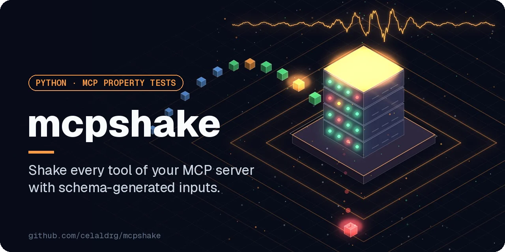
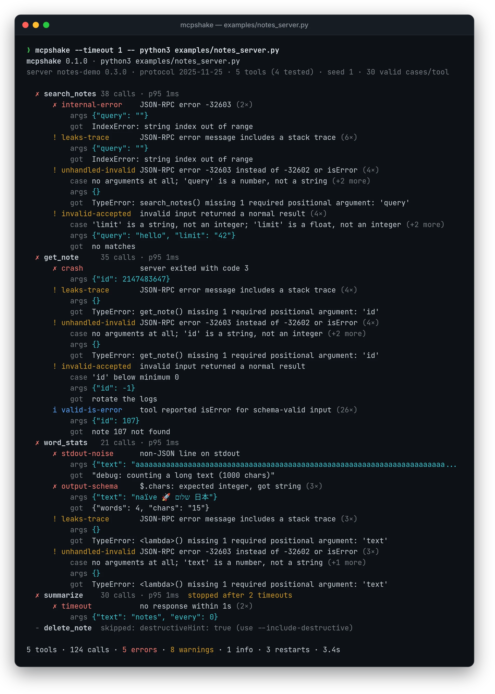
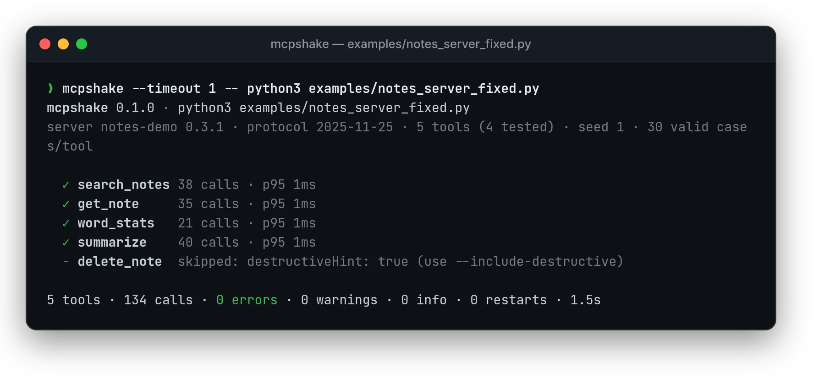

<p align="center">
  
</p>

<h3 align="center">Property-based tests for MCP servers: call every tool with generated arguments and catch what breaks.</h3>

<p align="center">
  <a href="https://github.com/celaldrg/mcpshake/actions/workflows/ci.yml"></a>
  <a href="https://github.com/celaldrg/mcpshake/releases"></a>
  <a href="LICENSE"></a>
  
  
</p>

## Why

An MCP server's `inputSchema` is a promise to every agent that calls it. Agents
will send exactly the inputs a happy-path test never tries: the empty string, the
boundary integer, the emoji, the 1000-character paste, the missing field. When a
tool falls over on those, the agent sees a hang, a dead connection or a Python
traceback in its context window, and the user sees "the MCP server is broken".

`mcpshake` starts your server over stdio, reads `tools/list`, and for every tool
generates **schema-valid** arguments (minimal, full, random and edge values) plus
**targeted invalid** ones (missing required fields, wrong types, out-of-range
numbers, values outside the enum, extra properties). It calls each tool with them
and reports what the server actually did:

<p align="center">
  
  <br><sub>Real output: <code>mcpshake --timeout 1 -- python3 examples/notes_server.py</code> finds all five planted bugs.</sub>
</p>

| Finding | Severity | What happened |
| --- | --- | --- |
| `crash` | error | the server process exited during the call (mcpshake restarts it and carries on) |
| `timeout` | error | no response within `--timeout` (an infinite loop on `every: 0`, say) |
| `stdout-noise` | error | a `print()` wrote non-JSON-RPC text to stdout, the protocol channel |
| `internal-error` | error | schema-valid input raised a JSON-RPC error such as `-32603` |
| `bad-result` | error | the result is not a valid `CallToolResult` (no `content` array, unknown content type) |
| `output-schema` | error | `structuredContent` is missing or does not match the tool's `outputSchema` |
| `unhandled-invalid` | warn | invalid input crashed the handler instead of being rejected with `-32602` or `isError` |
| `invalid-accepted` | warn | invalid input (wrong type, out of range) came back as a normal success |
| `valid-rejected` | warn | schema-valid input was rejected with `-32602 Invalid params` |
| `leaks-trace` | warn | an error message contains a stack trace (Python, Node, Go, Rust, Java) |
| `valid-is-error` | info | schema-valid input returned `isError: true` (often fine: "not found") |
| `slow` | info | p95 latency above `--slow` |

Every generated case is checked against the schema with a built-in validator
before it is sent, so a case is never labelled "valid" when the schema says
otherwise. Runs are deterministic: the same `--seed` replays the same cases, and
every finding shows the exact arguments that triggered it.

Fix the bugs and the same run comes back clean:

<p align="center">
  
</p>

## Install

Python 3.9 or newer, no dependencies.

```sh
# from the v0.1.0 release
pipx install https://github.com/celaldrg/mcpshake/releases/download/v0.1.0/mcpshake-0.1.0-py3-none-any.whl

# or straight from git
pipx install git+https://github.com/celaldrg/mcpshake

# or from source
git clone https://github.com/celaldrg/mcpshake && cd mcpshake && pip install -e .
```

## Usage

```sh
mcpshake [options] -- <server command> [args...]
```

```sh
mcpshake -- python3 server.py
mcpshake -- npx -y @modelcontextprotocol/server-everything
mcpshake --cases 100 --seed 7 -- uv run my-server         # more cases, another seed
mcpshake --tools 'search_*,get_*' --timeout 3 -- node dist/index.js
mcpshake --json -- python3 server.py > report.json
mcpshake --rules                                           # list every finding
```

| Option | Default | |
| --- | --- | --- |
| `--cases N` | 30 | schema-valid cases per tool; invalid cases are added on top |
| `--seed N` | 1 | random seed; same seed, same cases |
| `--timeout SEC` | 10 | per-call timeout; the server is restarted after a hang |
| `--slow MS` | 1000 | report tools whose p95 latency is above this |
| `--tools GLOB` / `--skip GLOB` | | choose tools (comma lists, repeatable) |
| `--include-destructive` | off | also call tools annotated `destructiveHint: true` |
| `--env KEY=VALUE`, `--cwd DIR` | | environment and working directory for the server |
| `--fail-on LEVEL` | `error` | exit 1 at `error`, `warn`, `info` or `never` |
| `--json` | | machine-readable report |
| `--github` | | GitHub Actions annotations |
| `-q`, `--quiet` | | only tools with findings |

Exit codes: `0` clean, `1` findings at or above `--fail-on`, `2` the server could
not be started or the command line was wrong.

### Safety

mcpshake really calls your tools. Point it at a sandbox, a test database or a
temp directory, never at production. Tools annotated `destructiveHint: true` are
skipped unless you pass `--include-destructive`, and tools that require task
augmentation (`execution.taskSupport: "required"`) are skipped too. Use `--skip`
for anything else you do not want called.

## Example

The repo ships a small notes server with five realistic bugs
([`examples/notes_server.py`](examples/notes_server.py)) and the same server with
them fixed ([`examples/notes_server_fixed.py`](examples/notes_server_fixed.py)).

<p align="center">
  
</p>

| Bug in the example | What mcpshake reports |
| --- | --- |
| `query[0]` on an empty string | `internal-error` + `leaks-trace` with `{"query": ""}` |
| `id + 1` overflows a 32-bit int and the process exits | `crash` with `{"id": 2147483647}` |
| a debug `print()` for long texts | `stdout-noise` with the 1000-character input |
| `chars` returned as a string for non-ASCII text | `output-schema`: `$.chars: expected integer, got string` |
| `while i < len(words): i += every` with `every: 0` | `timeout` with `{"text": "notes", "every": 0}` |

### In CI

```yaml
- run: pipx install git+https://github.com/celaldrg/mcpshake
- run: mcpshake --timeout 5 --github -- python3 server.py
```

### JSON

`--json` prints the server info, a summary and, per tool, the call counts, p95
latency and every finding with its rule, severity, count, the kinds of cases that
triggered it, the exact arguments and what came back.

## How it works

1. Start the server, send `initialize` (protocol `2025-11-25`) and
   `notifications/initialized`, page through `tools/list`.
2. For each tool, generate cases from `inputSchema`: types, `enum`/`const`,
   numeric bounds and `multipleOf`, string lengths, `pattern`, common `format`s,
   arrays, nested objects, `anyOf`/`oneOf`/`allOf` and local `$ref`s.
3. Validate each case against the schema; keep only correctly labelled ones.
4. Call `tools/call`, time it, watch stdout for stray output and stderr for the
   last words of a crash, check the result shape and `outputSchema`.
5. After a crash or hang, restart the server and continue; stop a tool after 2
   hangs or 5 crashes so one bad tool cannot stall the run.

## Prior art

The idea of generating test cases from a schema comes from property-based testing
([Hypothesis](https://hypothesis.works/), QuickCheck) and from
[Schemathesis](https://github.com/schemathesis/schemathesis), which does this for
OpenAPI. mcpshake is a small, dependency-free take on it for MCP tool schemas.
It is a robustness tester, not a security scanner: it does not send exploit
payloads. All code here is original.

## License

[MIT](LICENSE)
